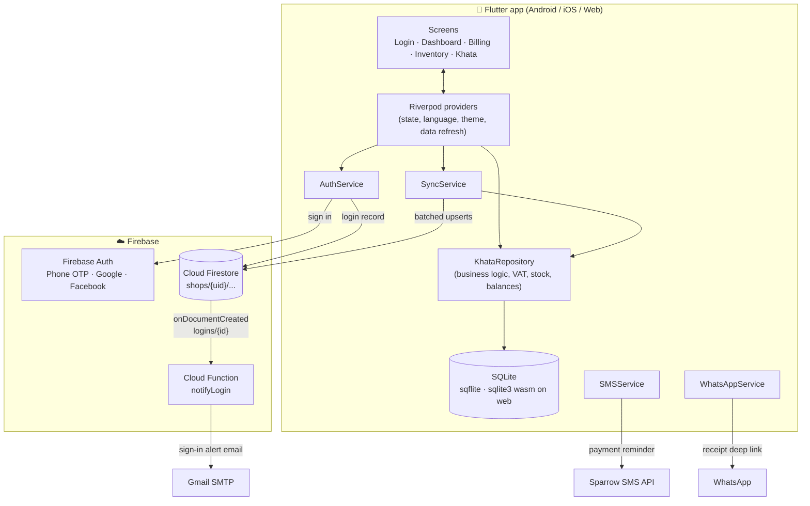
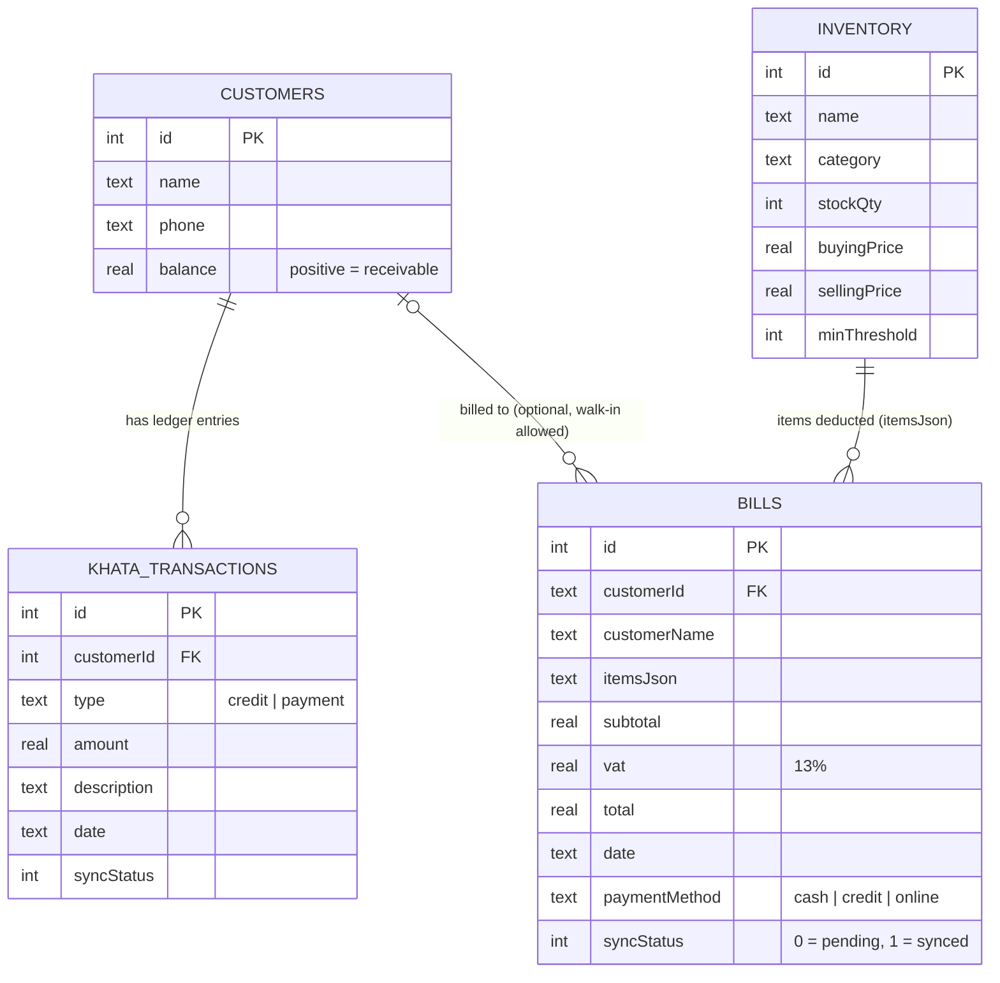
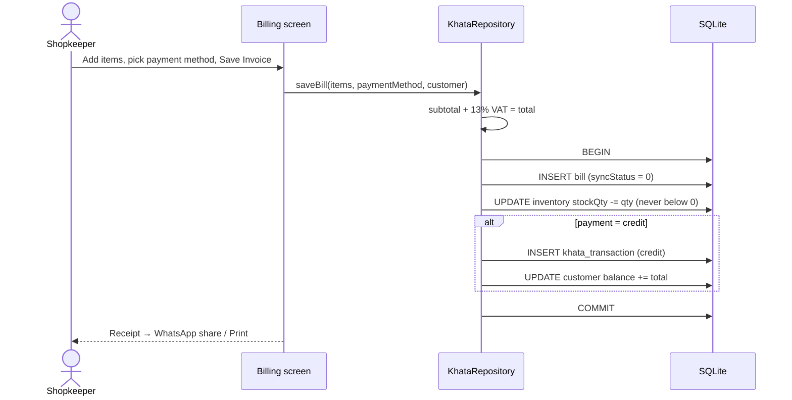
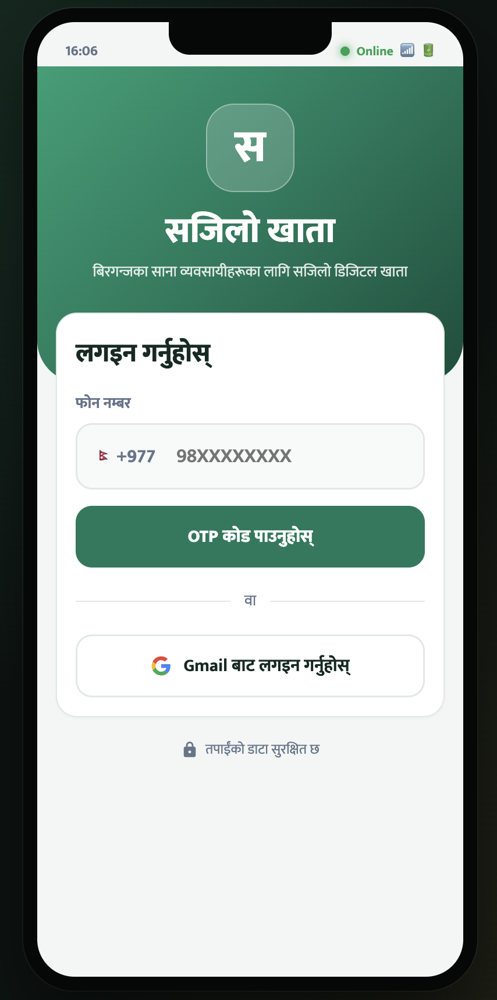
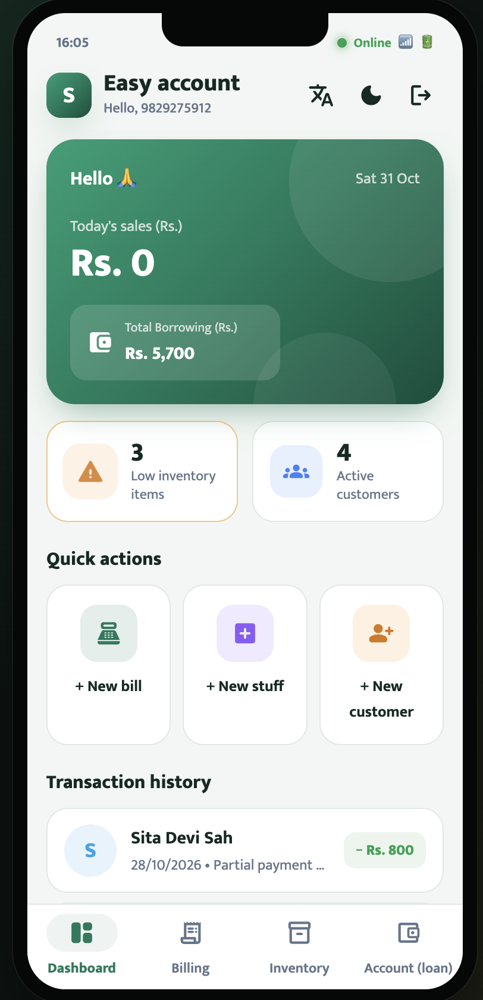
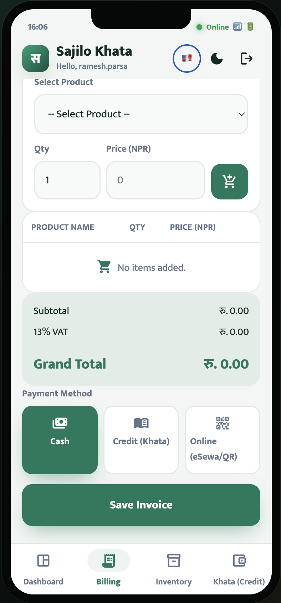
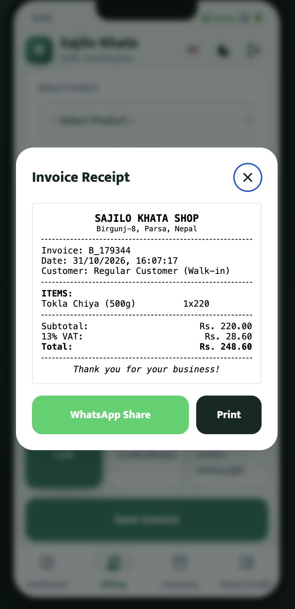
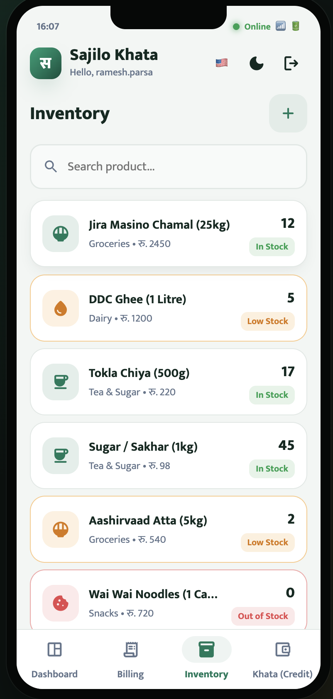
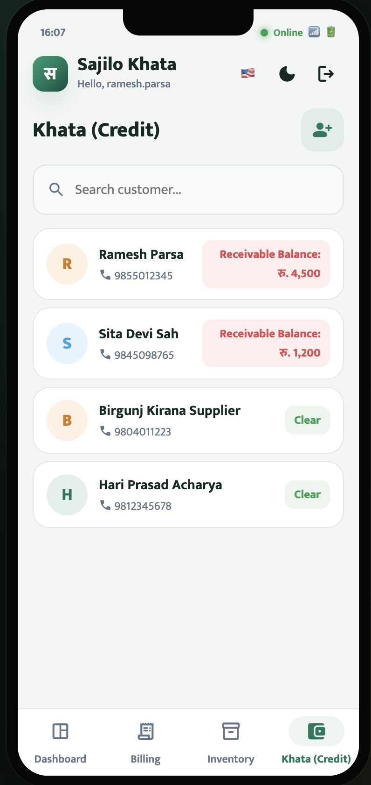

# Sajilo Khata Mobile

Sajilo Khata Mobile is a mobile-first, offline-first digital ledger and billing app for MSMEs in Nepal. It helps users manage customers, track credit and payments, generate invoices, apply VAT calculations, and sync data with Firebase when online. It is built with Flutter for fast, reliable everyday business use.

## Features

- **Dashboard** – today's sales, outstanding credit, low-stock alerts, recent khata activity
- **Billing** – cart with stock checks, 13% Nepal VAT, cash / credit / online payment, receipt shared via WhatsApp
- **Inventory** – search, add/edit/delete products, quick stock adjustment, low-stock highlighting
- **Khata ledger** – per-customer balance, give credit / receive payment, SMS payment reminders (Sparrow SMS)
- **Offline-first** – everything is stored in SQLite on the device; records are pushed to Cloud Firestore on sync
- Nepali / English UI, light & dark themes

## Tech Stack

- Flutter / Dart, Riverpod, SQLite (sqflite)
- Firebase Authentication & Cloud Firestore
- HTML, CSS and JavaScript (Vite) for the web prototype

## Project Structure

| Path | What it is |
| --- | --- |
| `sajilo_khata_mobile/` | Flutter app (Android / iOS / web) — the product |
| `index.html`, `app.js`, `db.js`, `locales.js`, `sparrow_sms.js`, `style.css` | Vite web prototype (localStorage-backed demo) |
| `functions/` | Cloud Function that emails a sign-in alert |
| `firestore.rules` | Firestore security rules |
| `firebase.json` | Firebase config: Hosting (web prototype), Functions, Firestore rules |

## System Design

### Architecture

The app is **offline-first**: every screen reads and writes a local SQLite database, so billing and
khata entries work with no internet. Firebase is only used for login, optional cloud backup and
sign-in alert emails.



### Layers

| Layer | Code | Responsibility |
| --- | --- | --- |
| Presentation | `lib/features/*`, `lib/shared/widgets` | Screens, dialogs, bottom navigation (`home_shell.dart`) |
| State | `lib/core/providers.dart` | Riverpod providers; `dataVersionProvider` is bumped after every write so lists and metrics re-fetch |
| Domain / data | `lib/core/database/khata_repository.dart` | Bills, stock deduction, ledger balances, dashboard metrics — each multi-table write runs in one SQLite transaction |
| Storage | `lib/core/database/database_helper.dart` | SQLite schema (4 tables) |
| Services | `lib/core/services/*` | Auth, Firestore sync, Sparrow SMS, WhatsApp sharing |
| Backend | `functions/`, `firestore.rules` | Sign-in alert email, per-user data isolation |

### Data model (local SQLite)



### Key flows

**Saving a bill** — one atomic SQLite transaction:



**Cloud sync** — tap the *Online* indicator:

1. `SyncService` reads bills and ledger entries with `syncStatus = 0`, plus all customers and products.
2. Writes them to `shops/{uid}/{bills,transactions,customers,inventory}` in Firestore batches of 450
   (Firestore's limit is 500 per batch).
3. Marks the pushed bills and transactions as synced locally.

**Login and sign-in alert**:

1. User signs in with phone OTP, Google or Facebook through Firebase Auth.
2. The app appends a record to `shops/{uid}/logins`.
3. The `notifyLogin` Cloud Function (region `asia-south1`) fires and emails the account owner via
   Gmail. Phone-only accounts have no email, so they are skipped.

### Security

- `firestore.rules` lets a signed-in user read/write only `shops/{their uid}/...`, limited to the
  four data collections; login records are create-only.
- Gmail credentials are stored as Cloud Functions secrets, never in the app.
- The test OTP `123456` only works in debug builds or with `--dart-define=DEV_LOGIN=true`.

## Getting Started

### Prerequisites

- Flutter SDK (includes Dart)
- Android Studio (Android) or Xcode (iOS) to run on a device or emulator
- A Firebase project for login (phone OTP, Google, Facebook) and cloud sync

### Run the Flutter app

```bash
git clone https://github.com/aashutosh-k-das/Sajilo_Khata_Mobile.git
cd Sajilo_Khata_Mobile/sajilo_khata_mobile
flutter pub get
flutter run              # or: flutter run -d chrome
```

Every account starts empty; there is no demo data.

### Login

The app signs users in with Firebase Authentication: **phone number + SMS OTP**, **Google**, and
optionally **Facebook**. Until Firebase is configured, a release build shows "Login is not set up yet".

For testing without Firebase, debug builds (`flutter run`) and builds made with
`--dart-define=DEV_LOGIN=true` accept the test OTP `123456` and keep data on the device. Never ship a
`DEV_LOGIN` build to real users.

On web the database runs on sqlite3 wasm. `web/sqlite3.wasm` must match the resolved `sqlite3`
package version in `pubspec.lock`; if they differ, the app shows a blank page.

### Setting up Firebase (required for real login and cloud sync)

1. Create a project at [console.firebase.google.com](https://console.firebase.google.com) and add a
   Firestore database.
2. Connect the app (writes `google-services.json`, `GoogleService-Info.plist` and `lib/firebase_options.dart`):
   ```bash
   dart pub global activate flutterfire_cli
   flutterfire configure
   ```
   Then in `lib/main.dart` import `firebase_options.dart` and change `Firebase.initializeApp()` to
   `Firebase.initializeApp(options: DefaultFirebaseOptions.currentPlatform)` (web needs these options).
3. In **Authentication > Sign-in method**, enable:
   - **Phone**: SMS OTP needs the Blaze (pay-as-you-go) plan. Add test numbers there to try it for free.
   - **Google**: add your app's SHA-1 and SHA-256 in **Project settings > Your apps > Android**:
     ```bash
     keytool -list -v -alias androiddebugkey -keystore ~/.android/debug.keystore -storepass android
     ```
     Then run `flutterfire configure` again so `google-services.json` includes the OAuth client.
   - **Facebook** (optional): create an app at [developers.facebook.com](https://developers.facebook.com),
     paste its App ID and App Secret into Firebase, and copy Firebase's redirect URI into the Facebook
     app's Facebook Login settings. Put the App ID and Client Token in
     `android/app/src/main/res/values/strings.xml` and `ios/Runner/Info.plist` (replace
     `000000000000000`), then build with `--dart-define=FACEBOOK_LOGIN=true`.

Synced data is written to `shops/{uid}/{bills,transactions,customers,inventory}`. Tap the Online
indicator in the app bar to sync.

### Sign-in alert emails

When someone signs in with Google (or Facebook), the app records the login in Firestore and the
`notifyLogin` Cloud Function in `functions/` emails the account owner: "your account was signed in
with Google on android at <time>". Phone-only accounts have no email, so they get no alert.

Setup (Cloud Functions need the Blaze plan):

1. Create a Gmail **App Password** for the sending account: Google Account > Security >
   2-Step Verification > App passwords.
2. Deploy:
   ```bash
   npm install -g firebase-tools && firebase login
   firebase use --add                                  # pick your Firebase project
   firebase functions:secrets:set GMAIL_USER           # e.g. sajilokhata.alerts@gmail.com
   firebase functions:secrets:set GMAIL_APP_PASSWORD   # the 16-character App Password
   cd functions && npm install && cd ..
   firebase deploy --only functions,firestore:rules
   ```

`firestore.rules` lets each user read and write only their own `shops/{uid}` data, and makes login
records append-only.

### Sparrow SMS reminders

```bash
flutter run --dart-define=SPARROW_SMS_TOKEN=your_token
```

Without a token, reminders open the phone's SMS app with the message pre-filled.

### Tests

```bash
flutter test
```

### Build

```bash
flutter build apk --release                         # Android, real login (needs Firebase)
flutter build apk --release --dart-define=DEV_LOGIN=true   # Android test build, OTP 123456
flutter build web        # Web
```

## Running the web prototype

```bash
npm install
npm run dev        # http://localhost:3000
npm run build      # outputs dist/ for Firebase Hosting
```

Use OTP `123456` (or the mock Gmail login) to sign in.

## Contributing

Contributions are welcome. Feel free to open issues or submit pull requests for improvements, bug fixes, and feature additions.

## License

Add your project license here if you want to define how others can use the code.

## Screenshots

| Login | Dashboard | Billing |
| :---: | :---: | :---: |
|  |  |  |
| **Invoice receipt** | **Inventory** | **Khata (credit)** |
|  |  |  |
